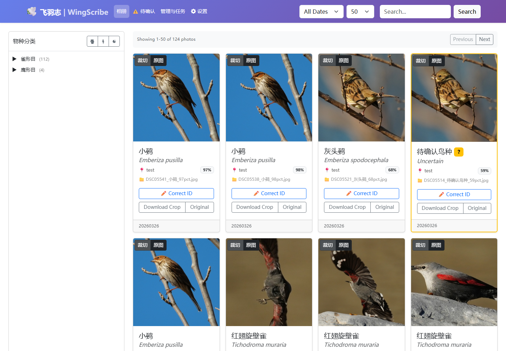
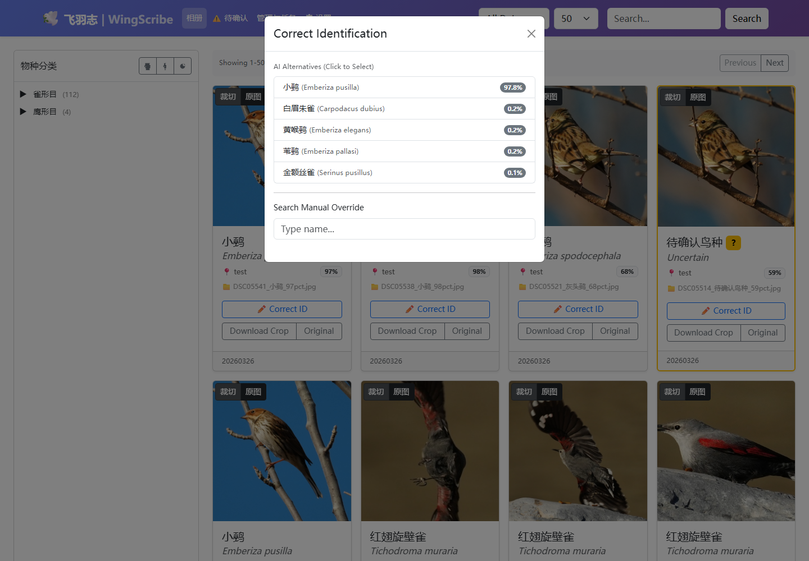
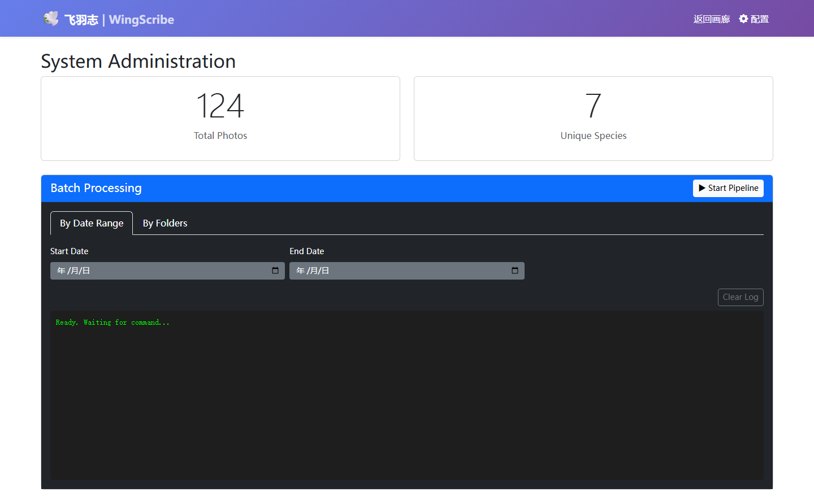

# WingScribe (飞羽志)

[简体中文](README.md) | **English**

WingScribe helps bird photographers work through a shoot on their own computer. It detects birds, crops images, suggests species, and organizes the results in a searchable gallery. You can also compare bursts at full resolution, mark keepers, and move rejected JPEGs into a recoverable quarantine.

[Download WingScribe 3.0.1](https://github.com/jiangyuyi/wingscribe/releases/tag/v3.0.1) · [English user guide](docs/en/guide.md) · [Upgrading from 2.3.1](docs/en/guide.md#upgrade-from-231)

## First run on Windows

1. Download the **CPU** installer for general use, or the **GPU** installer for a compatible NVIDIA graphics card. For GPU, download **every numbered `.bin` part** from the same release and put them beside the `.exe` before starting it.
2. Start WingScribe from its shortcut, keep the server window open, and visit `http://127.0.0.1:8000/settings`. Under **设置** (Settings), use **选择文件夹** (Choose folder) to select a source containing a few JPEG copies and a separate output folder. Save and restart WingScribe.
3. Open `/admin` to scan a folder or date range. The first local recognition run needs the configured BioCLIP weights and may take time to encode species names. Open `/` to inspect the crops, original photos, and suggested species. Open `/culling` to compare shots from a burst.

The 3.0.0 application interface is in Chinese. The English guide includes the on-screen terms for the main actions. **Manual species corrections can write metadata to the original photo**, including when automatic source write-back is disabled. Use copies for your first run.

## What you can do

| Task | How WingScribe handles it |
| --- | --- |
| Identify and archive birds | YOLO detects bird subjects. Local BioCLIP recognition ranks species from the AviList catalogue. Review the candidates before confirming a label. |
| Compare a burst | Pick the subject to score, compare two crops at native resolution, and choose between ranked candidates and up to three recommendations per group. |
| Revisit a shoot | The catalogue tracks file versions. An unchanged analysis can be reused when the file and analysis settings match. |
| Review rejects | Save a decision first, preview the exact list, then confirm a move to quarantine. You can restore the file to its original path. |
| Use a NAS | Open photos through an OS-mounted share or Windows UNC path. Keep the SQLite database on a local disk. |

## Run from source

From the repository root, with Python 3.11 or 3.12, uv, and ExifTool available:

```powershell
uv sync --locked --extra cpu
.\.venv\Scripts\Activate.ps1
python src/web/app.py --host 127.0.0.1 --port 8000
```

For CUDA 12.8, select `--extra cu128` instead of `--extra cpu`. The Web UI and recognition service have no effective access authentication. Use a local or trusted environment.

## Screenshots





| Batch processing | Settings |
| --- | --- |
|  |  |

## Further reading

The [English guide](docs/en/guide.md) covers setup, configuration, backups, taxonomy migration, culling, the recognition API, development, and troubleshooting. For the proposed application language switch, see the [localization feasibility assessment](docs/en/localization-feasibility.md). The [Chinese documentation index](docs/README.md) also links to detailed engineering records, model evaluations, and historical material. WingScribe began as a personal learning and research project. BioCLIP 2 is the example configuration; BioCLIP 2.5 remains experimental.

WingScribe is released under the [MIT license](LICENSE). The bundled taxonomy and third-party tools have their own attributions. Thanks to AviList, IOC World Bird List, BioCLIP, Ultralytics, and the contributors to WingScribe.
