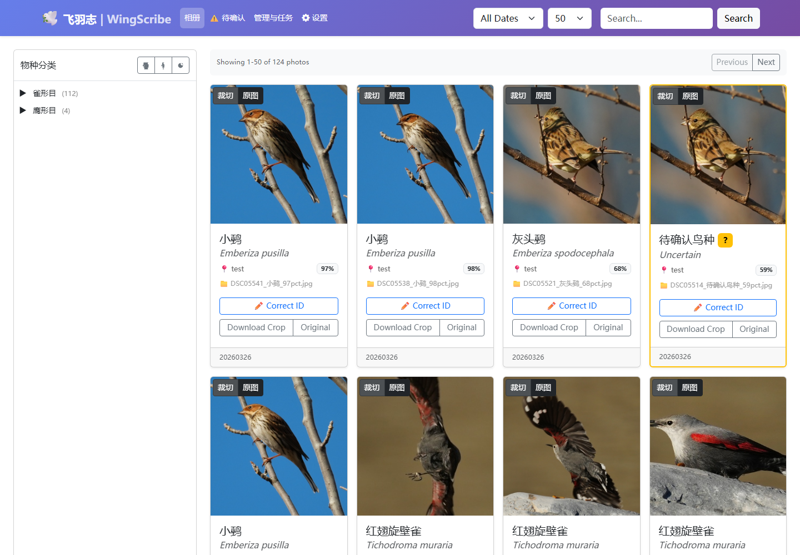
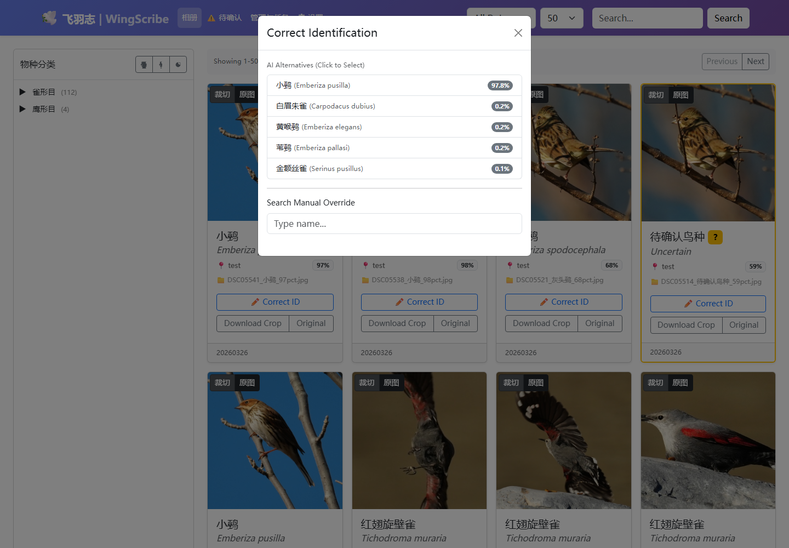
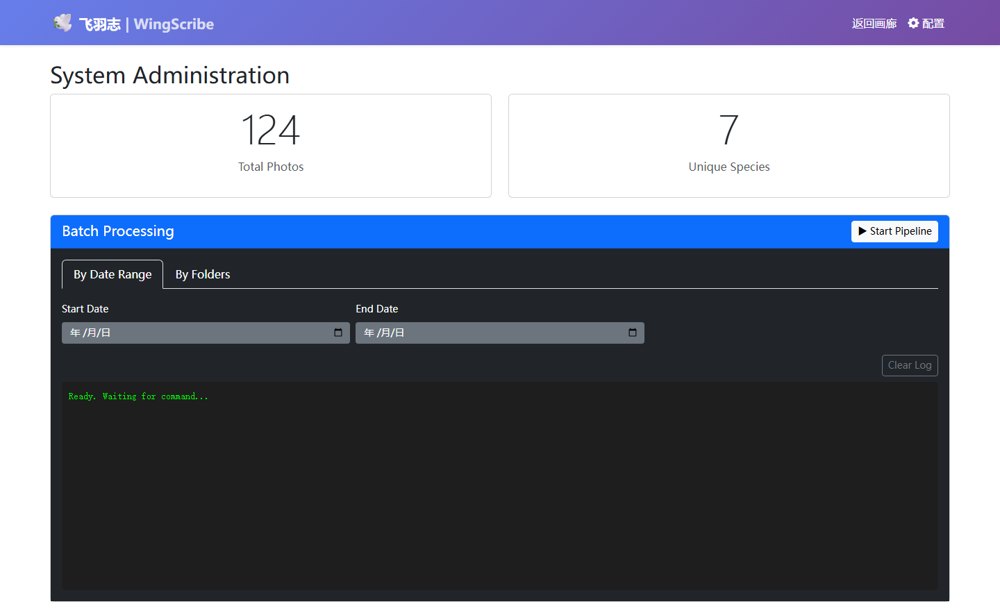

# WingScribe（飞羽志）

面向鸟类摄影的本地照片识别与整理工具：扫描照片目录，检测和裁切鸟体，识别物种，写入元数据，并通过 Web 图库进行人工校对。

这是一个从学习和研究出发、借助多个 AI 工具逐步搭建的个人项目。文档按当前仓库实现整理；实验结果和早期方案分别保存，不作为已发布功能承诺。

[文档总览](docs/README.md) · [安装与使用](docs/user/getting-started.md) · [配置](docs/user/configuration.md) · [项目状态与已知问题](docs/development/status.md)

## 当前能力

- 按日期或目录扫描、YOLO 检测、裁切和可配置质量检查。
- 本地 BioCLIP 识别、Top-K 候选、IOC 分类及人工确认记录。配置样例选用 BioCLIP2；BioCLIP 2.5 保持实验选项。
- 图库筛选、原图/裁切图对照、人工校对、按模板归档和 EXIF/IPTC/XMP 写入。
- 本地磁盘及操作系统挂载的 NAS；SQLite 数据库。
- 独立识别 API 和云适配器已存在，但与照片流水线使用不同接口，限制见 [识别 API](docs/reference/recognition-api.md)。

## 开始使用

Windows 安装包入口：[GitHub Releases](https://github.com/jiangyuyi/wingscribe/releases)。选择 CPU 或 NVIDIA GPU 包，安装后通过快捷方式启动，在 `/settings` 配置照片源和输出目录。

源码运行使用 Python 3.11 环境，并安装可在命令行调用的 ExifTool。在仓库根目录执行：

```powershell
python -m venv venv
.\venv\Scripts\Activate.ps1
python -m pip install -r requirements.txt
```

首次启动前从配置样例准备 `config/settings.yaml` 并填写合法路径，已有配置不需覆盖。执行 `python src/web/app.py --host 127.0.0.1 --port 8000` 后，访问 `http://127.0.0.1:8000/settings` 调整配置。首次使用、名录导入和 Linux/macOS 操作见 [安装与使用](docs/user/getting-started.md)。

人工校对当前会尝试修改原图元数据；`write_back_to_source: false` 只约束自动流水线。首次验证建议使用照片副本。Web 和识别 API 尚无有效访问认证，使用范围见 [项目状态](docs/development/status.md)。

## 界面





| 批处理管理 | 配置页面 |
| --- | --- |
|  |  |

## 进一步阅读

- 使用者：[NAS](docs/user/nas.md)、[名录与中文分类](docs/user/taxonomy.md)。
- 开发者：[架构](docs/development/architecture.md)、[开发与测试](docs/development/contributing.md)、[安装器构建](installer/README.md)。
- 研究：[公共评测](docs/research/evaluation.md)、[2026-08-18 结果](docs/research/results-2026-08-18.md)、[软先验](docs/research/prior-reranking.md)。
- 历史：[归档说明](docs/archive/README.md)、[本次文档整理清单](docs/maintenance/document-inventory.md)。

项目使用 [MIT 许可证](LICENSE)。感谢 IOC World Bird List、BioCLIP、Ultralytics 及相关开源项目。
